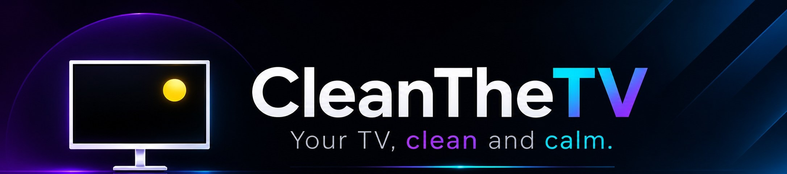
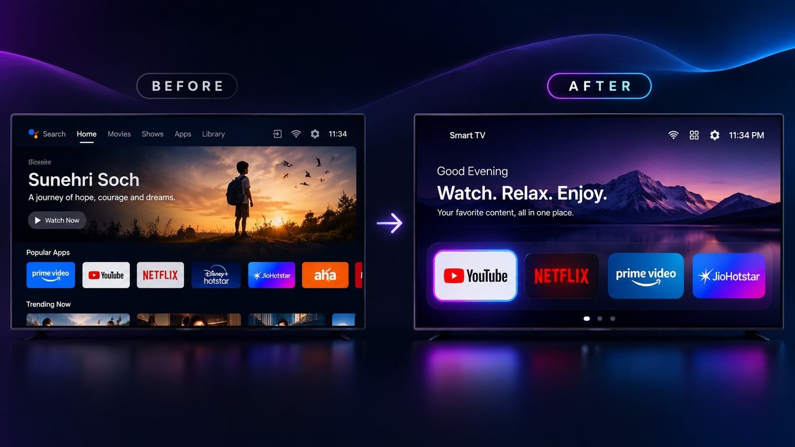
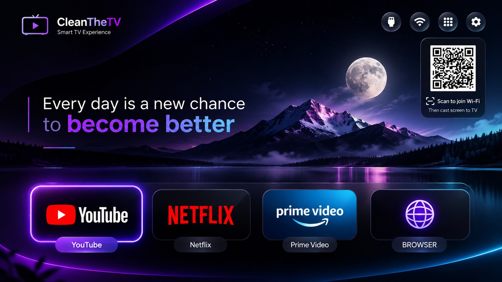
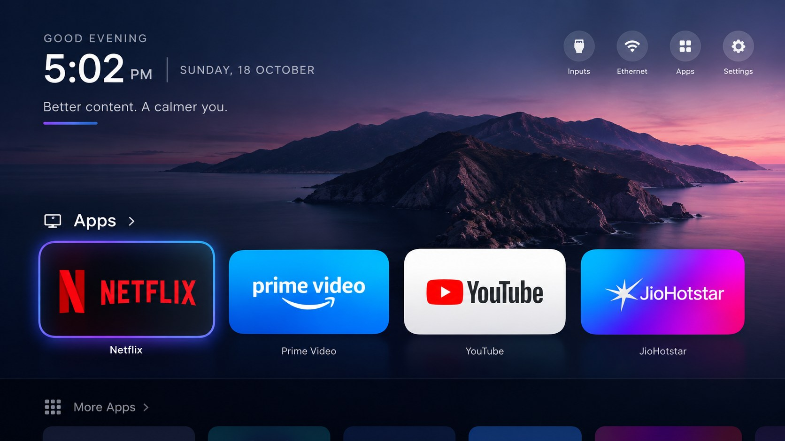

<p align="center">
  
</p>

<p align="center">
  <br>
  <sub><i>Concept illustration of the idea, not a screenshot.</i></sub>
</p>

<p align="center">
  <a href="LICENSE"></a>
  
  
  
</p>

**CleanTheTV** strips the ads, sponsored rows and tracking apps off an Android TV or Google TV over Wi-Fi, and
replaces the cluttered home screen with a calm, dark one: your favourite apps in a dock, a line of your own on the
screen, and an optional QR code that lets guests join your Wi-Fi to cast their phone.

No root. No cable. **Nothing is uninstalled**, and one command puts everything back.

## Start here

| You have | Go to |
|---|---|
| **An Android TV or Google TV and a Windows PC on the same Wi-Fi** | [Quick start](#quick-start) |
| **A Samsung, LG, Roku or Vizio TV** | Not supported: those platforms have no ADB. |
| **Want to see it first** | [What you get](#what-you-get) and [Themes](#themes) |
| **Something went wrong** | [Restoring your TV](#restoring-your-tv) |

## What you get

| Feature | What it does |
|---|---|
| **A clean home screen** | A dock of your favourite apps, a glass app library for the rest, and no sponsored rows. |
| **Ads and tracking apps switched off** | The manufacturer's telemetry, ad services and preloaded junk are disabled with `pm disable-user`. Nothing is removed. |
| **Your own line on screen** | `header_quote` puts a message in the middle of Home. With `header_quote_style: "terminal"` it reads like a shell prompt. |
| **Guest-cast QR** | Shows a QR that joins whichever saved Wi-Fi the TV is on. [How it works](docs/guest-cast-qr.md) |
| **Hide the clock and date** | `show_clock: false` for a calmer screen. |
| **Ready-made themes** | `terminal-dark` and `aurora-glass`, plus every theme inherited from the upstream project. |
| **One command** | `cleanthetv.ps1` finds the TV, picks the tested list for its model and does the whole job. |
| **Before/after report** | `report` shows free RAM, running processes and disabled apps against the reading `setup` took before it changed anything. |
| **System-wide ad and tracker blocking** | `privacy` switches on private DNS (AdGuard by default). No root, and `privacy -Dns off` puts the TV back exactly as it was. |
| **A draft list for any TV** | `scan` writes a draft debloat list for a TV that has no tested list, for you to review. |
| **Safe by design** | Everything is recorded, and `cleanthetv.ps1 restore` undoes it. |

## Quick start

On the TV: **Settings > Device Preferences > About**, press OK on **Build** seven times, go back to **Developer
options** and turn **USB debugging** on (and **Network debugging** if you see it). Keep the TV on and on the same Wi-Fi as
your PC.

On the PC, in PowerShell, from this folder:

```powershell
.\cleanthetv.ps1 setup -DryRun      # see what would happen. Changes nothing.
.\cleanthetv.ps1 setup              # do it
```

Then accept **Allow USB debugging?** on the TV (tick *Always allow*). `setup` will:

1. Find the TV on your network and read its model.
2. Pick the **tested debloat list for that model** from [`examples/`](examples/). Choices the list's author made for themselves (voice assistant, casting, unused apps) are **skipped**, so voice and casting keep working; add `-IncludePersonalChoices` to disable them too. No list for your TV? The debloat step is skipped and the rest still works.
3. Disable the listed apps, install the CleanTheTV launcher as Home and push the theme.

> Python 3 is needed for one step (the tools create their own private environment). You also need a launcher APK in
> `dist\` (a release download, or [build it](#building-the-launcher)).

## Beyond debloating

```powershell
.\cleanthetv.ps1 report              # free RAM, processes and disabled apps, now vs before setup
.\cleanthetv.ps1 privacy -Dns adguard   # block ad and tracker domains for the whole TV (undo: -Dns off)
.\cleanthetv.ps1 scan                # TV with no tested list? write a draft list to review
```

**`report`** takes a reading automatically before `setup` changes anything, so you can show real numbers afterwards.
RAM and process counts move around, so reboot the TV and wait a minute before each reading.

**`privacy`** sets Android's *private DNS* (DNS over TLS) to AdGuard, Quad9, Cloudflare or a hostname you choose. On the
test TV, `doubleclick.net` resolved to a real Google address before and to `127.0.0.1` (blocked) with AdGuard. It cannot
remove ads served from the same address as the video, such as YouTube's. Your DNS provider can see which site names the
TV looks up (not the pages). If the TV cannot resolve names through the server, the setting is reverted by itself.

**`scan`** looks at the TV's system apps and guesses from their names which are analytics, advertising, sponsored content
or silent partner installs. It writes a **draft** and applies nothing. On the test TV it caught 8 of the 16 packages in the
tested list; it misses ones whose names give nothing away (such as the manufacturer's content home screen). Treat it as a
starting point, review every line, and then run `setup -ListFile <file> -DryRun`.

## Themes

```powershell
.\cleanthetv.ps1 theme -Theme terminal-dark
.\cleanthetv.ps1 theme -Theme aurora-glass
```

| Theme | Look |
|---|---|
| `terminal-dark` | Near-black with a blue glow, a shell-style line in the middle of Home, dark cards, and a coloured glow that follows the focused app. No clock. |
| `aurora-glass` | A flowing violet, blue and orange gradient with a frosted-glass dock, the clock and a greeting. |





*These are concept illustrations of each look, not screenshots: the real launcher differs in details, such as having no logo in the header. The guest-cast QR is the code at the top right of the first one.*

Make your own by copying a folder in [`themes/`](themes/) and editing `config.json`. Every key is listed in
[`themes/README.md`](themes/README.md).

## Guest-cast QR

Add the Wi-Fi networks the TV uses to your theme:

```json
"wifi_qr_networks": ["MyHomeWiFi=my-password", "MyPhoneHotspot=other-password"]
```

When the TV is on a listed network, Home shows a QR code that joins it. Scanning it connects the guest's phone to the
**same Wi-Fi as the TV**; they then use **Cast / Smart View** on the phone and pick the TV. On any other network the QR is
hidden, so it never shows a code that would not work.


Read [the limits and the security note](docs/guest-cast-qr.md) before using it: the QR contains the password.

## Customising

New options added by CleanTheTV (set them in a theme's `config.json`):

| Key | Type | What it does |
|---|---|---|
| `show_clock` | bool | `false` hides the clock and date. |
| `header_quote` | string | Your own line in the middle of Home, in place of the greeting. |
| `header_quote_style` | `"terminal"` or empty | `"terminal"` shows the quote after a shell prompt in a monospace font. |
| `header_quote_prompt` | string | The prompt before the quote in terminal style (`clean@tv:~$` by default). |
| `wifi_qr_networks` | list of `"SSID=password"` | The guest-cast QR for the network the TV is on. |

All the upstream keys (dock, columns, wallpaper, glass, glow, library and more) still work. See
[`themes/README.md`](themes/README.md).

## Restoring your TV

```powershell
.\cleanthetv.ps1 restore
```

This resets the theme, re-enables every app that was disabled and brings the stock launcher back. Packages that were
already disabled before CleanTheTV stay disabled. You can also re-enable a single app with
`adb shell pm enable <package>`. More in [docs/restore.md](docs/restore.md).

## Supported TVs

Anything running **Android TV** or **Google TV**. [`examples/`](examples/) holds one folder per model with the list of
apps to disable. Those lists come from the upstream project's contributors.

**Honest status:** CleanTheTV's one-command setup, themes, quote, clock option and guest-cast QR have been tested end to end
on **one TV**: a Xiaomi MiTV-AXSO0 running Android 9. Other models use the upstream lists, which are community-tested but
not re-tested here. Please report what happens on yours.

## FAQ

**Will it brick my TV?** No. Apps are disabled, not removed, the stock launcher is only disabled after the new one is
installed, and `restore` reverses it.

**Will firmware updates undo it?** Sometimes. See [docs/firmware-updates.md](docs/firmware-updates.md); run `setup`
again if so.

**Does it work on iPhone casting?** The guest-cast QR only gets the phone on the Wi-Fi. Android phones can then
screen-cast to a Chromecast-enabled TV. iPhones can only cast from apps that support Chromecast, because the TV does not
speak AirPlay.

**Where do my Wi-Fi passwords go?** Only into your own theme file and onto your TV. Never commit a theme that contains
real ones.

## Building the launcher

You need a JDK 17 to 22 and the Android SDK (platform 34, build-tools 34):

```powershell
cd launcher
.\gradlew.bat assembleRelease
```

The APK lands in `launcher\app\build\outputs\apk\release\`.

## Credits and license

CleanTheTV is a derivative of **[CleanYourTV](https://github.com/Gathin23/cleanyourtv)** by Gathin and its contributors,
released under the MIT license. The launcher, tools and device lists come from that project; CleanTheTV adds the one-command
`cleanthetv.ps1`, the `show_clock`, `header_quote`, `header_quote_style` and `wifi_qr_networks` options, the QR drawing
(using [ZXing](https://github.com/zxing/zxing), Apache 2.0) and the `terminal-dark` and `aurora-glass` themes.

Released under the [MIT license](LICENSE), which keeps the original copyright notice.

> This project is not affiliated with or endorsed by Google, Xiaomi or any TV maker. Product names are used only to say
> what the software works with.


